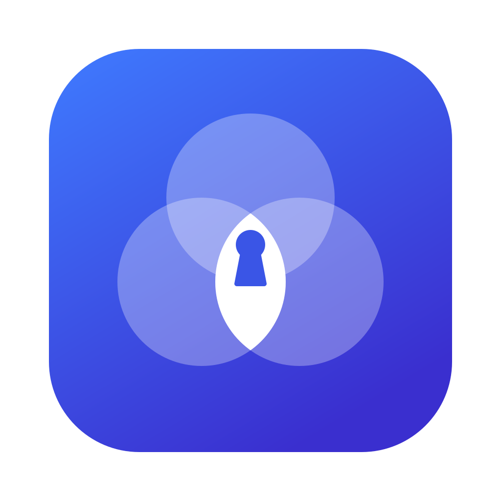
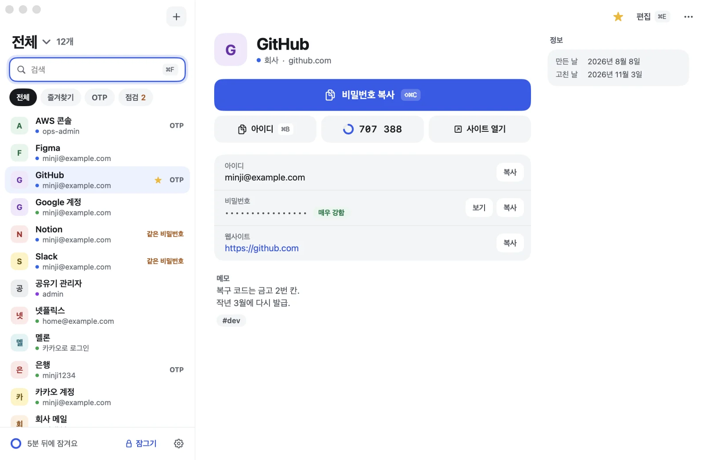
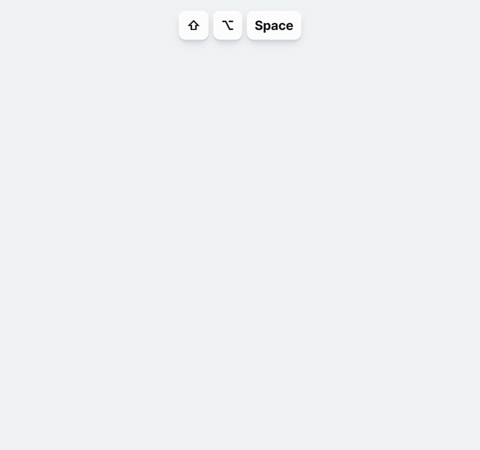
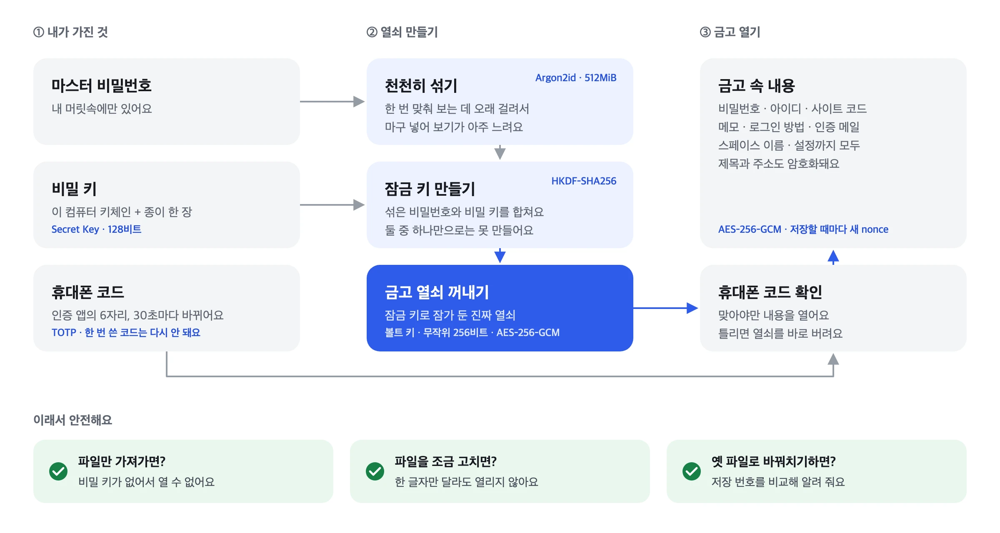

<div align="center">



# Keystead

**Your passwords stay on your computer**

No server, no account, no sync. The Mac and Windows apps open the same vault file.

### [Download →](https://github.com/leeahwi/keystead/releases/latest)


[Website](https://leeahwi.github.io/keystead/en/) · [How it protects you](#how-it-protects-you) · [Backup and moving](#backup-move-restore) · [한국어](README.md) · **English**

</div>

<br>



<sub>Real app windows with example data. The app UI is in Korean.</sub>

## Why Keystead

- **Nothing leaves your computer.** The vault is one encrypted file on your machine. No server means no server to breach.
- **A leaked file won't open.** It needs both the master password and the Secret Key, and the app also asks for the phone code.
- **Two or three letters, and it's copied.** Press <kbd>⇧⌥Space</kbd> in any app, type, hit <kbd>↵</kbd>. If it's locked, unlock it right there.

| | Needed to open | Where it lives |
| :---: | --- | --- |
| **1** | Master password | Your head |
| **2** | Secret Key (128-bit, starts with `SV1-`) | This computer's Keychain, plus one sheet of paper |
| **3** | 6-digit code | The authenticator app on your phone |

## Get started in 3 minutes

**1. Download** the file for your OS from the [latest release](https://github.com/leeahwi/keystead/releases/latest).

| | File | How |
| --- | --- | --- |
| **macOS 14+** | `Keystead-<version>-macOS.dmg` | Open it and drag `Keystead` to `Applications` |
| **Windows 10/11** | `Keystead_<version>_x64-setup.exe` | Run it |

**2. Open it once by hand.** The builds aren't notarized by Apple or code-signed for Windows yet, so the OS blocks the first launch. On a **Mac**, right-click Keystead in Finder and choose **Open**. On **Windows**, click **More info → Run anyway** in SmartScreen.

**3. Set it up** in about two minutes: enter a **master password** twice, write the **Secret Key** on paper and confirm its last 4 characters, then scan the **QR code** with an authenticator app and enter the 6-digit code.

> [!IMPORTANT]
> **Keep the Secret Key paper and the OTP key away from the computer.** They're the only way back in after you change computers or lose your phone.

### Check that the download is genuine (recommended)

Someone could re-upload Keystead with malware inside, so every release ships `SHA256SUMS` and its signature `SHA256SUMS.sig`. Put the downloaded files in one folder, get this repository (**Code → Download ZIP** or `git clone`), and run:

```sh
scripts/verify-release.sh ~/Downloads/keystead-v0.9.0
```

```powershell
powershell -ExecutionPolicy Bypass -File scripts\verify-release.ps1 -Dir $HOME\Downloads\keystead-v0.9.0
```

If it prints `모두 확인했습니다` (all verified), the files are genuine. A file it couldn't check, or one that isn't in the list, makes it fail. From v0.9.0 the signed list also carries the version, so it fails when that differs from the folder name (`keystead-v0.9.0`) or the version you pass as the second argument: an older release can't be passed off as the latest. Public keys are in [.github/release-signing/](.github/release-signing/):

| Key | Fingerprint | Releases |
| --- | --- | --- |
| Laptop Secure Enclave key | `SHA256:AQwd7gTjutxsdxShSYdAQoP+qquJb1K7X8AofRSubAU` | v0.8.0 on. The key never leaves the developer's Mac Secure Enclave and every signature needs Touch ID |
| Previous laptop key | `SHA256:U6EENbTlPu90iiZSQjBSImelxY60hD9BujDdZLhk8E8` | v0.5.3 – v0.7.0. Not accepted from 2026-11-06 |
| CI key | `SHA256:haNkzmNl/aFJ/FKWVIBcqGHoHASlxSDlGGcNnhb8HbA` | Was for GitHub Actions builds. Not accepted from 2026-11-09 |
| Previous key | `SHA256:FjJfSvHqxzn5u+Z4cipjFMkOqINdKrHPBrIj8wC6HVY` | v0.2.2 – v0.5.2. Not accepted from 2026-11-06 |

Only open Keystead from this repository's [releases](https://github.com/leeahwi/keystead/releases).

> [!WARNING]
> The Windows app is built and format-checked but hasn't been run on a real Windows PC yet — that includes the quick search window, Windows Hello and the tray icon.

## What you can do

**Find it from anywhere.** In the browser, press <kbd>⇧⌥Space</kbd> (Windows <kbd>Alt+Shift+Space</kbd>) and a small quick search window appears. Type a few letters and <kbd>↵</kbd> copies the password.



**Unlock it right there.** If the vault is locked, quick search asks for Touch ID · Windows Hello (or the master password) and the phone code, then goes straight to search — no detour to the main window.


**Fingerprint or face.** Touch ID on Mac, Windows Hello (fingerprint, face or PIN) on Windows. The password is asked again after 3 days or a restart. Optional **Touch ID only / Windows Hello only** skips the phone code (off by default; turning it on asks for the master password).

**Spaces.** Work, Personal, Other or your own, switched with <kbd>⌘1</kbd>–<kbd>⌘9</kbd>.

**Generate, and see codes.** Passwords (16 characters by default) with strength in bits; live 6-digit site codes with time left.

**Note how you sign in.** The site's own password and/or Google · Naver · Kakao · Apple and other providers, with the linked account. The Google account's card lists every site that signs in with it.

**Spot weak passwords.** Weak and reused passwords, checked on this machine only, with a fix right there.

<details>
<summary><b>Shortcuts</b></summary>

<br>

| Action | macOS | Windows |
| --- | --- | --- |
| Quick search (from any app) | <kbd>⇧⌥Space</kbd> | <kbd>Alt+Shift+Space</kbd> |
| Search box | <kbd>⌘F</kbd> | <kbd>Ctrl+F</kbd> |
| All / space 1–9 | <kbd>⌘0</kbd> / <kbd>⌘1</kbd>–<kbd>⌘9</kbd> | <kbd>Ctrl+0</kbd> / <kbd>Ctrl+1</kbd>–<kbd>Ctrl+9</kbd> |
| Copy password | <kbd>⇧⌘C</kbd> or <kbd>↵</kbd> | <kbd>Ctrl+Shift+C</kbd> or <kbd>Enter</kbd> |
| Copy username | <kbd>⌘B</kbd> | <kbd>Ctrl+B</kbd> |
| New · edit | <kbd>⌘N</kbd> · <kbd>⌘E</kbd> | <kbd>Ctrl+N</kbd> · <kbd>Ctrl+E</kbd> |
| Lock now | <kbd>⌘L</kbd> | <kbd>Ctrl+L</kbd> |

Closing the window keeps Keystead running (Dock on Mac, notification area on Windows), so the shortcut always works. Quit with <kbd>⌘Q</kbd> on Mac, or “Keystead 끝내기” from the tray icon on Windows.

</details>

## How it protects you

<picture>
  <source media="(prefers-color-scheme: dark)" srcset="site/assets/shots/diagram-encryption-dark.webp">
  
</picture>

| Threat | Defense |
| --- | --- |
| Password guessing | Argon2id costs 512 MiB and about 0.6 s per guess (Apple M series). Files with weaker settings are refused |
| Leaked file | The Secret Key is mixed into the key (1Password-style 2SKD), so even a weak password can't be brute-forced |
| Reading contents | AES-256-GCM with a fresh nonce on every save. Titles, URLs, notes and space names are all encrypted |
| Tampering | The whole header is bound as GCM associated data; one changed byte and the file won't open |
| Rollback | A save counter is also kept in the Keychain; if the file actually opened is older, you're warned |
| After a password leak | Changing the master password also makes a new vault key, and backups that open with the old password are deleted |
| Touch ID · Windows Hello (optional) | The unlock key is sealed to a Secure Enclave key / a key derived from a Windows Hello signature. The password is asked again after 3 days or a restart. Those rules and the “… only” choice are bound by an HMAC keyed from the vault key, so editing files can't change them. Windows Hello includes the **Windows PIN** |
| Memory and screen | Secrets are wiped after use, debugger attach and core dumps are blocked, windows ask the OS to be left out of screenshots (not every capture tool honours it) |
| Clipboard | Cleared after the set time and flagged so clipboard history and cloud clipboard skip it |
| Walking away | Locks on sleep, screen lock, user switch and idle — and 12 hours after unlocking, whatever else happens |
| Fake releases | Signed hashes. The signing key lives in the developer's Mac Secure Enclave and every signature needs Touch ID |

A full security review (crypto design, both apps, distribution) was done in November 2026; what it found was fixed in 0.8.0.

> [!CAUTION]
> **What it can't protect against:** a computer already taken over by malware (including a program running as you that asks for your fingerprint), an unlocked computer left unattended, and other apps reading the clipboard during the few seconds a value is there. The phone code is an extra step in the app, not encryption; the Secret Key is the real second factor against a leaked file.

## Backup, move, restore

**There is one file to back up**: `~/.securevault/vault.svlt` (Windows `%USERPROFILE%\.securevault\vault.svlt`). It's already encrypted, so any USB stick, disk or cloud folder is fine. Keep the Secret Key paper somewhere else.

<details>
<summary><b>Move to another computer</b> (Mac ↔ Windows works the same way)</summary>

<br>

1. Install Keystead on the new computer but don't open it yet.
2. Put `vault.svlt` into `~/.securevault/` (Windows `%USERPROFILE%\.securevault\`).
3. Open Keystead and enter the Secret Key, your master password and the phone code.

If you see the new-vault setup, quit without continuing and start again from step 2. Don't edit the same vault on two computers; changes aren't merged.

</details>

<details>
<summary><b>Restore an older version</b></summary>

<br>

Settings → **예전 상태로 되돌리기** (go back to an earlier state), pick a version and enter the master password it was saved with. If the app won't open: quit it, move the current `vault.svlt` aside, copy the version you want from `backups/` to `vault.svlt`, and choose **그래도 열기** (open anyway) on the old-file warning. If that warning appears without you restoring anything, someone may have swapped the file: choose **열지 않기** (don't open).

</details>

| Lost | What you can do |
| --- | --- |
| Secret Key paper | With the computer: Settings → Emergency kit, and write it again |
| The computer | With the paper and a file backup: same as moving to a new computer |
| Phone, OTP key written down | Add the key to an authenticator on the new phone |
| Master password | No way to recover |

## Privacy

Keystead collects nothing: no account, server, analytics, crash reporting, update check or ads, and neither app has code that connects to the internet. A browser opens only when you click **열기** (open) on an entry (http/https only).

## Reports

Bugs: [issues](https://github.com/leeahwi/keystead/issues). Security problems: privately, per the [security policy](SECURITY.md).

This repository holds the releases, the website and the tools to verify downloads. The app is under the [Apache License 2.0](LICENSE); third-party notices are in [NOTICE](NOTICE).

<div align="center"><br><sub>© 2026 leeAhwi</sub></div>
