<div align="center">

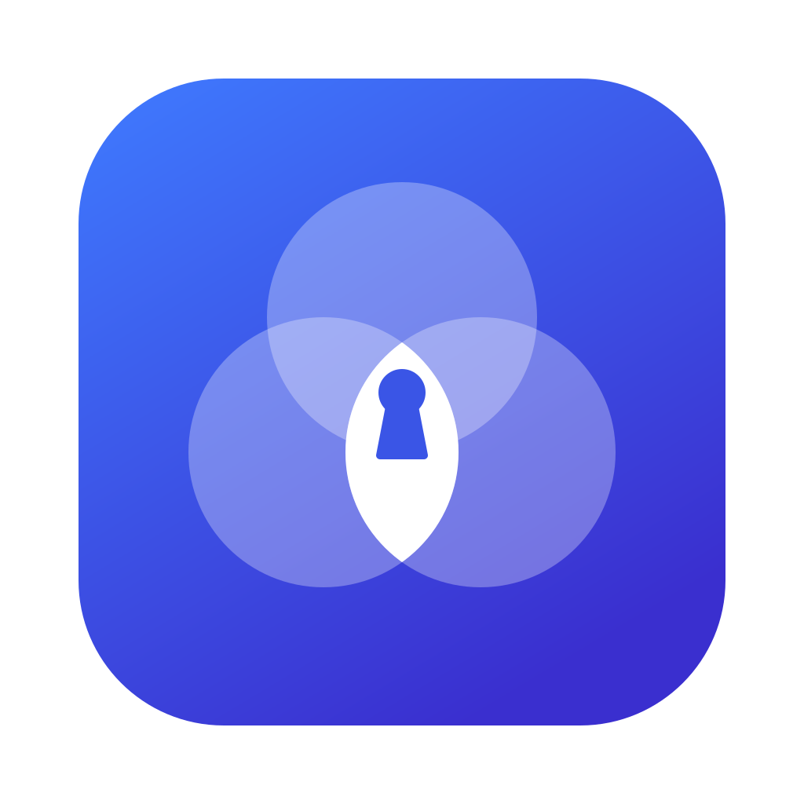

# Keystead

**비밀번호를 내 컴퓨터에만 둬요**

서버도 계정도 없어요. Mac과 Windows에서 같은 금고 파일을 열어요.

### [내려받기 →](https://github.com/leeahwi/keystead/releases/latest)


[소개 페이지](https://leeahwi.github.io/keystead/) · [어떻게 지키나요](#어떻게-지키나요) · [백업과 이동](#백업--이동--복원) · **한국어** · [English](README.en.md)

</div>

<br>

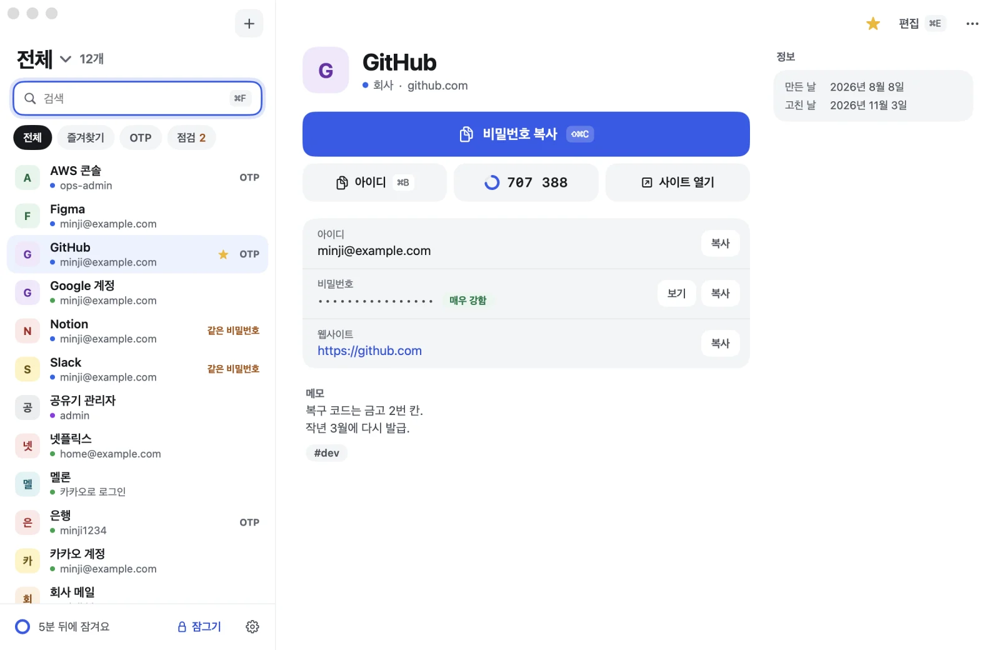

<sub>앱 창에 예시 데이터를 넣어 찍은 화면이에요.</sub>

## 무엇이 좋은가요

- **아무것도 밖으로 나가지 않아요.** 금고는 내 컴퓨터에 있는 암호화된 파일 하나예요. 서버가 없으니 남의 서버가 털려도 상관없어요.
- **파일이 새어 나가도 열 수 없어요.** 마스터 비밀번호와 비밀 키가 둘 다 있어야 열리고 앱은 휴대폰 코드까지 물어요.
- **두세 글자면 복사돼요.** 어느 앱을 쓰다가도 <kbd>⇧⌥Space</kbd>로 찾고 <kbd>↵</kbd>를 누르면 돼요. 잠겨 있으면 그 자리에서 풀어요.

| | 열 때 필요한 것 | 어디에 있나요 |
| :---: | --- | --- |
| **1** | 마스터 비밀번호 | 내 머릿속 |
| **2** | 비밀 키(Secret Key, `SV1-`로 시작하는 128비트 키) | 이 컴퓨터의 키체인, 그리고 종이 한 장 |
| **3** | 휴대폰 코드(6자리) | 휴대폰 인증 앱 |

## 3분이면 시작해요

**1. 받기** — [최신 릴리스](https://github.com/leeahwi/keystead/releases/latest)에서 내 컴퓨터에 맞는 파일을 받아요.

| | 받을 파일 | 설치 |
| --- | --- | --- |
| **macOS 14 이상** | `Keystead-<버전>-macOS.dmg` | 열어서 `Keystead`를 `Applications`로 끌어다 놓아요 |
| **Windows 10/11** | `Keystead_<버전>_x64-setup.exe` | 실행해요 |

**2. 처음 열기** — 아직 Apple 공증과 Windows 코드 서명이 없어서 처음 한 번은 OS가 막아요. **Mac**은 Finder에서 Keystead를 우클릭하고 **열기**, **Windows**는 SmartScreen에서 **추가 정보 → 실행**을 눌러요.

**3. 처음 설정** — 2분이면 끝나요.

<picture>
  <source media="(prefers-color-scheme: dark)" srcset="site/assets/shots/diagram-setup-dark.webp">
  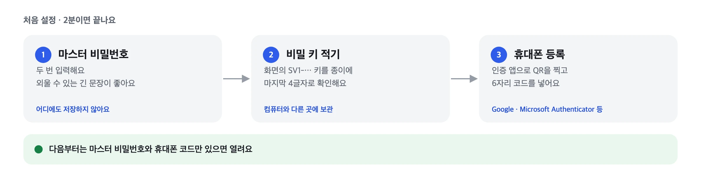
</picture>

> [!IMPORTANT]
> **비밀 키(Secret Key) 종이와 OTP 키는 컴퓨터와 다른 곳에 보관하세요.** 컴퓨터를 바꾸거나 휴대폰을 잃었을 때 되찾는 유일한 방법이에요. OTP 화면의 4글자 묶음 키를 같은 종이에 적어 두면, 휴대폰을 잃어도 다른 인증 앱에 다시 넣을 수 있어요.

### 받은 파일이 진짜인지 확인하기 (권장)

누군가 악성코드를 넣은 Keystead를 다른 곳에 올릴 수 있어서 릴리스마다 파일 해시 목록 `SHA256SUMS`와 그 서명 `SHA256SUMS.sig`를 함께 올려요. 받은 파일을 한 폴더에 모으고 이 저장소를 받아(초록 **Code → Download ZIP** 또는 `git clone`) 확인 스크립트를 실행해 보세요.

```sh
scripts/verify-release.sh ~/Downloads/keystead-v0.9.0
```

```powershell
powershell -ExecutionPolicy Bypass -File scripts\verify-release.ps1 -Dir $HOME\Downloads\keystead-v0.9.0
```

`모두 확인했습니다`가 나오면 진짜예요. 확인하지 못한 파일이나 목록에 없는 파일이 있으면 실패로 알려요. v0.9.0부터는 서명된 목록 안에 버전도 적혀 있어서, 폴더 이름(`keystead-v0.9.0`)이나 두 번째 인자로 준 버전과 다르면 실패해요. 예전 판을 최신이라고 속여 내밀 수 없어요. 공개 키는 [.github/release-signing/](.github/release-signing/)에 있어요.

| 키 | 지문 | 쓰는 판 |
| --- | --- | --- |
| 노트북 보안 칩 키 | `SHA256:AQwd7gTjutxsdxShSYdAQoP+qquJb1K7X8AofRSubAU` | v0.8.0부터. 키가 개발자 Mac의 보안 칩 밖으로 나오지 않고, 서명할 때마다 Touch ID를 물어요 |
| 이전 노트북 키 | `SHA256:U6EENbTlPu90iiZSQjBSImelxY60hD9BujDdZLhk8E8` | v0.5.3 ~ v0.7.0. 2026-11-06부터는 이 키의 서명을 받지 않아요 |
| CI 키 | `SHA256:haNkzmNl/aFJ/FKWVIBcqGHoHASlxSDlGGcNnhb8HbA` | GitHub Actions 빌드용이었어요. 2026-11-09부터는 이 키의 서명을 받지 않아요 |
| 이전 키 | `SHA256:FjJfSvHqxzn5u+Z4cipjFMkOqINdKrHPBrIj8wC6HVY` | v0.2.2 ~ v0.5.2. 2026-11-06부터는 이 키의 서명을 받지 않아요 |

이 저장소의 [릴리스](https://github.com/leeahwi/keystead/releases)가 아닌 곳에서 받은 Keystead는 열지 마세요.

> [!WARNING]
> Windows 앱은 빌드와 파일 호환까지 확인했지만 실제 Windows PC에서는 아직 돌려 보지 않았어요. 빠른 검색 창 · Windows Hello · 알림 영역 아이콘도 그래요.

## 이런 걸 할 수 있어요

**어디서든 바로 찾아요.** 브라우저를 쓰다가 <kbd>⇧⌥Space</kbd>(Windows는 <kbd>Alt+Shift+Space</kbd>)를 누르면 작은 빠른 검색 창이 떠요. 두세 글자 치고 <kbd>↵</kbd>면 비밀번호가 복사돼요.

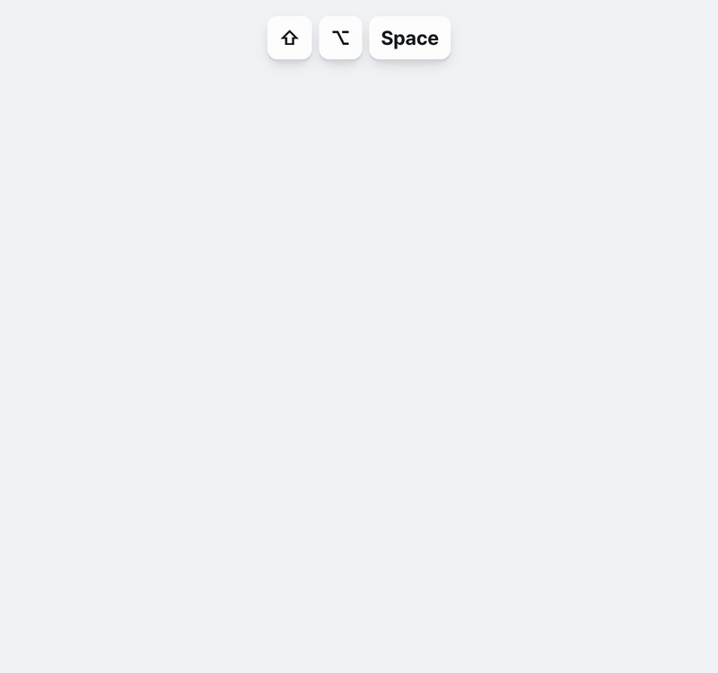

**잠겨 있으면 그 자리에서 풀어요.** 빠른 검색 창에서 Touch ID · Windows Hello(또는 마스터 비밀번호)와 휴대폰 코드를 받고 풀리면 바로 검색칸이에요. 앱 창으로 넘어가지 않아요.


**지문 · 얼굴로 열어요.** Mac은 Touch ID, Windows는 Windows Hello(지문 · 얼굴 · PIN)로 열 수 있어요. 3일이 지나거나 컴퓨터를 다시 켜면 비밀번호를 물어요. 원하면 **Touch ID만으로 열기 · Windows Hello만으로 열기**를 켜서 휴대폰 코드를 건너뛸 수 있어요(기본은 꺼짐, 켤 때 마스터 비밀번호 확인).

**스페이스로 나눠요.** 회사 · 개인 · 기타처럼 금고를 나누고 <kbd>⌘1</kbd>~<kbd>⌘9</kbd>로 오가요. 이름과 색은 직접 정해요.

**만들고, 코드도 보여 줘요.** 길이(기본 16자)와 기호를 고르면 비밀번호를 만들고 강도를 비트로 보여 줘요. 사이트 OTP 키나 `otpauth://` 주소를 넣으면 6자리 코드가 남은 시간과 함께 바뀌어요.

**어떻게 로그인하는지 적어 둬요.** 아이디 · 비밀번호와 Google · 네이버 · 카카오 · Apple 같은 연동 로그인을 함께 고르고 연동한 계정을 적어요. Google 계정 항목에는 ‘이 계정으로 로그인하는 곳’이 모여서 계정 하나가 털렸을 때 어디가 영향을 받는지 바로 보여요.

**약한 비밀번호를 알려 줘요.** 약하거나 여러 곳에 같이 쓰는 비밀번호를 골라 보여 주고 그 자리에서 새로 만들게 안내해요. 검사는 이 컴퓨터 안에서만 해요.

<table>
  <tr>
    <td width="50%">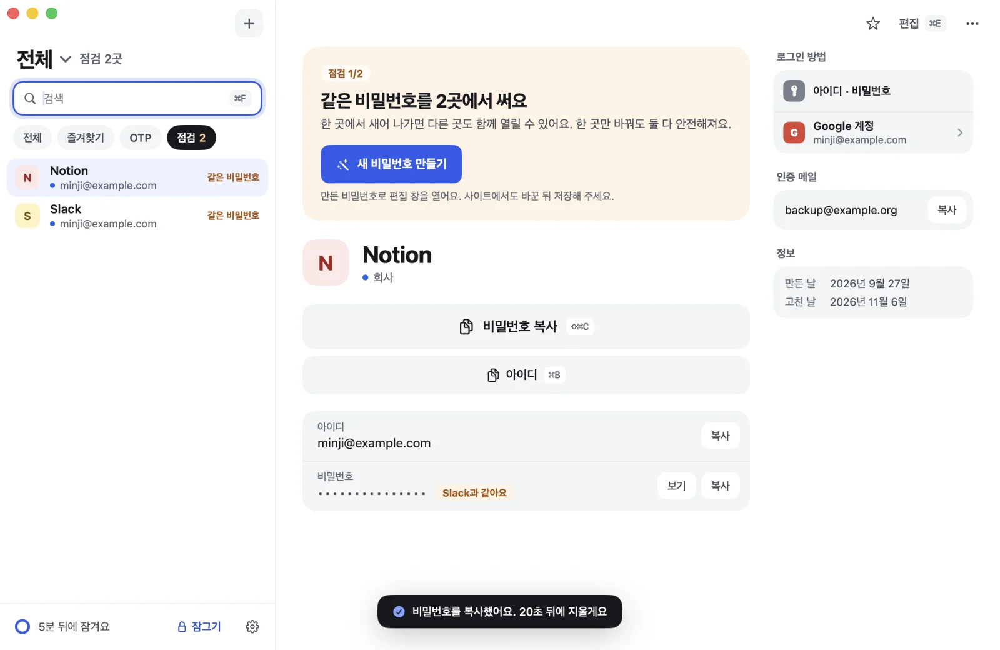</td>
    <td width="50%">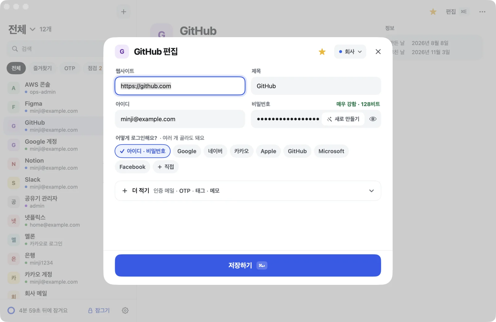</td>
  </tr>
  <tr>
    <td align="center"><sub><b>점검</b> · 겹치는 비밀번호를 바로 바꾸게 안내해요</sub></td>
    <td align="center"><sub><b>편집</b> · 주소를 넣으면 제목과 로그인 방법을 추천해요</sub></td>
  </tr>
</table>

<details>
<summary><b>단축키</b></summary>

<br>

| 하는 일 | macOS | Windows |
| --- | --- | --- |
| 빠른 검색 (다른 앱에서도) | <kbd>⇧⌥Space</kbd> | <kbd>Alt+Shift+Space</kbd> |
| 검색칸으로 | <kbd>⌘F</kbd> | <kbd>Ctrl+F</kbd> |
| 전체 / 스페이스 1~9 | <kbd>⌘0</kbd> / <kbd>⌘1</kbd>~<kbd>⌘9</kbd> | <kbd>Ctrl+0</kbd> / <kbd>Ctrl+1</kbd>~<kbd>Ctrl+9</kbd> |
| 비밀번호 복사 | <kbd>⇧⌘C</kbd> 또는 <kbd>↵</kbd> | <kbd>Ctrl+Shift+C</kbd> 또는 <kbd>Enter</kbd> |
| 아이디 복사 | <kbd>⌘B</kbd> | <kbd>Ctrl+B</kbd> |
| 새 항목 · 편집 | <kbd>⌘N</kbd> · <kbd>⌘E</kbd> | <kbd>Ctrl+N</kbd> · <kbd>Ctrl+E</kbd> |
| 바로 잠그기 | <kbd>⌘L</kbd> | <kbd>Ctrl+L</kbd> |

창을 닫아도 Keystead는 켜져 있어요(Mac은 Dock, Windows는 작업 표시줄 오른쪽 알림 영역). 그래서 빠른 검색 단축키가 늘 통해요. 끄려면 Mac은 <kbd>⌘Q</kbd>, Windows는 알림 영역 아이콘에서 ‘Keystead 끝내기’를 눌러요.

</details>

<details>
<summary><b>설정에서 바꿀 수 있는 것</b></summary>

<br>

- 자동 잠금: 1 · 5 · 15 · 30 · 60분 (연 지 12시간이 지나면 무조건 잠가요)
- 복사한 것 지우기: 10 · 20 · 30 · 60초
- Touch ID로 열기 · Touch ID만으로 열기 (Mac), Windows Hello로 열기 · Windows Hello만으로 열기 (Windows)
- 마스터 비밀번호 바꾸기 (금고 열쇠도 새로 만들고 예전 비밀번호로 열리는 기록은 지워요)
- 비상 키트 보기 (비밀번호를 한 번 더 물어요)
- 휴대폰 코드 다시 등록 (휴대폰을 바꿀 때)
- 예전 상태로 되돌리기, 금고 파일 따로 저장
- 스페이스 이름 · 색

</details>

## 어떻게 지키나요

파일이 새어 나가도, 비밀번호가 약해도 열 수 없게 만드는 게 목표예요. 1Password · Bitwarden · KeePassXC의 방식을 살펴보고 로컬 전용 앱에 맞는 것만 골랐어요.

<picture>
  <source media="(prefers-color-scheme: dark)" srcset="site/assets/shots/diagram-where-dark.webp">
  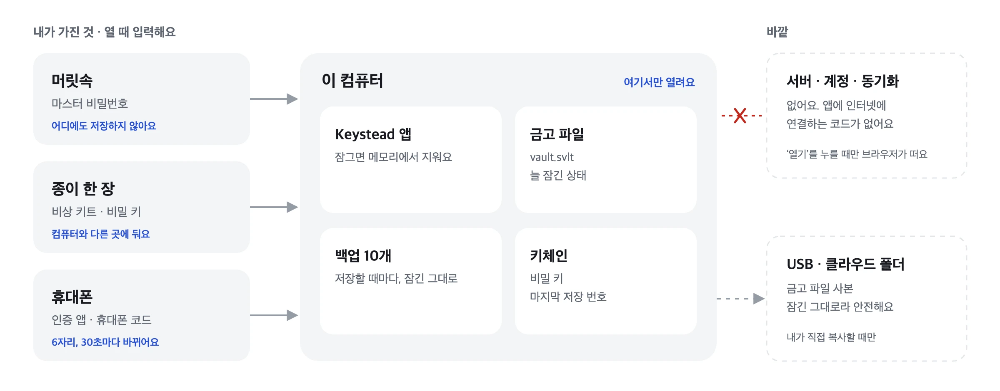
</picture>

**금고는 이렇게 열려요.** 마스터 비밀번호와 비밀 키가 함께 있어야 열쇠가 나오고 앱은 휴대폰 코드까지 맞아야 내용을 보여 줘요. 휴대폰 코드는 앱이 하는 확인이라, 파일 · 비밀번호 · 비밀 키를 모두 가진 사람까지 막지는 못해요.

<picture>
  <source media="(prefers-color-scheme: dark)" srcset="site/assets/shots/diagram-encryption-dark.webp">
  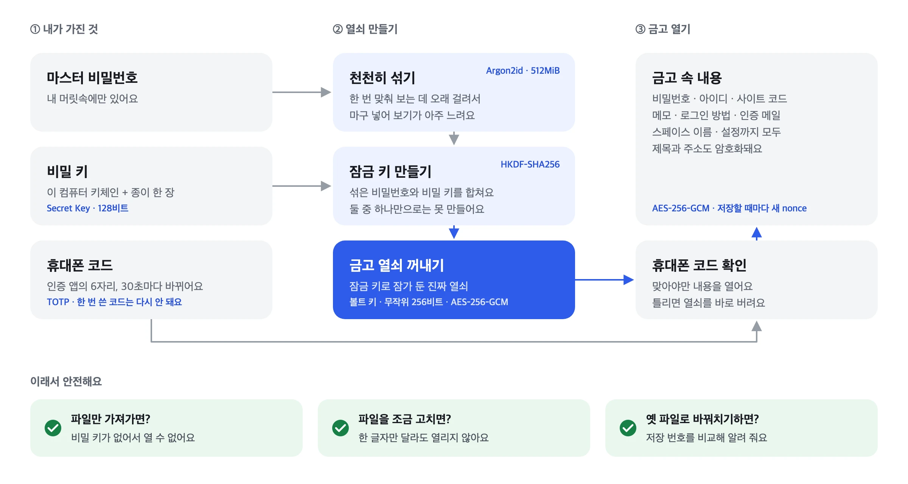
</picture>

| 무엇을 막나요 | 어떻게 |
| --- | --- |
| 비밀번호 대입 | Argon2id로 한 번 시도에 메모리 512 MiB와 0.6초 남짓(Apple M 시리즈). 이보다 약한 설정의 파일은 열지 않아요 |
| 파일 유출 | 128비트 비밀 키가 비밀번호와 함께 키를 만들어요(1Password 2SKD 방식). 비밀번호가 약해도 대입할 수 없어요 |
| 내용 노출 | AES-256-GCM, 저장할 때마다 새 nonce. 제목 · URL · 메모 · 스페이스 이름까지 모두 암호화 |
| 파일 위변조 | 머리글 전체를 GCM 인증 데이터로 묶어서 한 글자만 바꿔도 열리지 않아요 |
| 옛 파일로 바꿔치기 | 저장 번호를 키체인에도 적어 두고 실제로 연 파일이 더 오래됐으면 경고해요 |
| 비밀번호가 샌 뒤 | 마스터 비밀번호를 바꾸면 금고 열쇠도 새로 만들어요. 예전 비밀번호로 열리는 기록은 지워요 |
| 연속 실패 | 3번째부터 기다리는 시간이 2배씩 늘어요(최대 15분). 파일만 지워서는 풀리지 않아요 |
| Touch ID · Windows Hello (선택) | 잠금 해제 키를 Mac 보안 칩 키 · Windows Hello 서명으로 만든 키로 잠가요. 3일 · 재시작 뒤에는 비밀번호를 다시 물어요. 이 규칙과 ‘…만으로 열기’ 선택은 금고 열쇠로 만든 확인 값에 묶여서 폴더의 파일을 고쳐 바꿀 수 없어요. Windows Hello에는 **Windows PIN**도 들어가요 |
| 메모리 · 화면 | 비밀 값은 다 쓰면 지우고, 디버거 연결과 코어 덤프를 막아요. 창이 스크린샷과 화면 녹화에 찍히지 않게 OS에 요청해요(모든 캡처 도구가 따르지는 않아요) |
| 클립보드 | 정해진 시간 뒤 지우고, 클립보드 기록 · 클라우드 클립보드에 남지 않게 표시해요 |
| 자리 비움 | 잠자기 · 화면 잠금 · 사용자 전환 · 정해진 시간 동안 안 쓰면 잠가요. 연 지 12시간이 지나면 무조건 잠가요 |
| 가짜 배포 | 릴리스 해시에 서명해요. 서명 키는 개발자 Mac의 보안 칩 안에 있어서 꺼낼 수 없고 서명마다 Touch ID를 물어요 |

2026년 11월에 처음부터 다시 보안 점검을 했어요(암호 설계 · 두 앱 · 배포). 찾은 문제는 0.8.0에서 고쳤어요.

> [!CAUTION]
> **이런 건 막지 못해요.**
> - 이미 악성코드에 장악된 컴퓨터(키로거, 메모리를 읽는 프로그램, 같은 사용자 권한으로 지문 확인을 요청하는 프로그램)
> - 잠금이 풀린 채 자리를 비운 컴퓨터
> - 복사해 둔 몇 초 동안 다른 앱이 클립보드를 읽는 것
> - 휴대폰 코드는 앱을 여는 단계를 하나 더 두는 장치예요. 파일 · 비밀번호 · 비밀 키를 모두 가진 사람이 직접 만든 프로그램으로 여는 것까지는 막지 못해요. 파일 유출을 막는 진짜 두 번째 열쇠는 비밀 키예요.

## 백업 · 이동 · 복원

금고는 파일 하나라서 백업도, 옮기기도, 되돌리기도 그 파일을 다루는 일이에요.

<picture>
  <source media="(prefers-color-scheme: dark)" srcset="site/assets/shots/diagram-backup-dark.webp">
  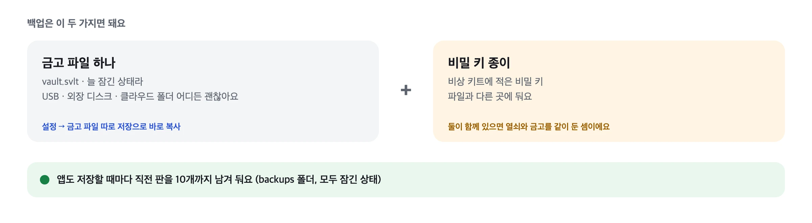
</picture>

금고 파일은 Mac `~/.securevault/vault.svlt`, Windows `%USERPROFILE%\.securevault\vault.svlt`에 있어요. 설정 → **금고 파일 따로 저장**으로 원하는 곳에 바로 복사할 수도 있어요.

<details>
<summary><b>다른 컴퓨터로 옮기기</b></summary>

<br>

<picture>
  <source media="(prefers-color-scheme: dark)" srcset="site/assets/shots/diagram-move-dark.webp">
  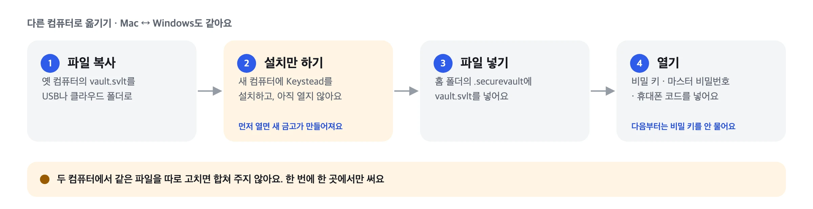
</picture>

```sh
mkdir -p ~/.securevault && cp /Volumes/USB/vault.svlt ~/.securevault/
```

Windows는 탐색기 주소창에 `%USERPROFILE%\.securevault`를 넣고 그 폴더에 붙여 넣어요. 새 금고 만들기 화면이 먼저 나왔다면 진행하지 말고 앱을 끈 뒤 3번부터 다시 해요. 두 컴퓨터에서 같은 파일을 따로 고치면 합쳐 주지 않아요.

</details>

<details>
<summary><b>예전 상태로 되돌리기</b></summary>

<br>

<picture>
  <source media="(prefers-color-scheme: dark)" srcset="site/assets/shots/diagram-restore-dark.webp">
  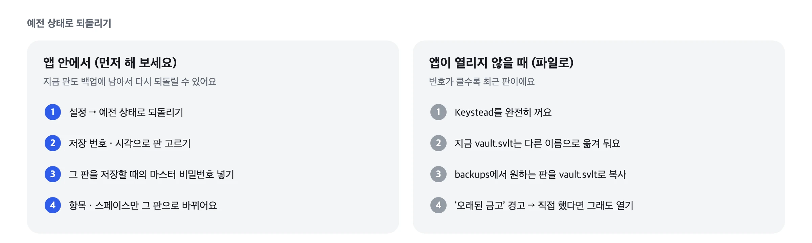
</picture>

설정 · OTP · 비밀번호는 지금 그대로예요. 되돌린 적이 없는데 **마지막으로 연 것보다 오래된 금고예요** 경고가 뜨면 누군가 파일을 바꿔치기했을 수 있어요. **열지 않기**를 누르고 파일을 확인해 보세요.

</details>

<details>
<summary><b>무언가를 잃어버렸을 때</b></summary>

<br>

<picture>
  <source media="(prefers-color-scheme: dark)" srcset="site/assets/shots/diagram-lost-dark.webp">
  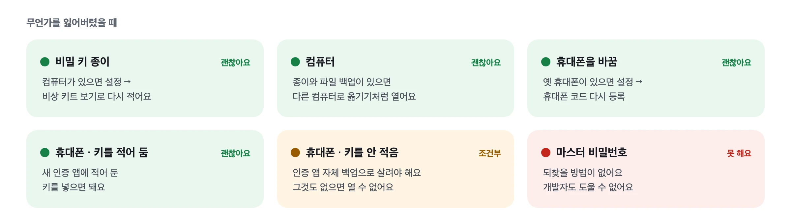
</picture>

비밀번호와 키를 어디에도 맡기지 않는 대신, 잃어버리면 개발자도 도와줄 수 없어요.

</details>

## 개인정보와 삭제

Keystead는 아무것도 모으지 않아요. 계정 · 서버 · 사용 통계 · 오류 보고 · 업데이트 확인 · 광고가 없고 두 앱 모두 인터넷에 연결하는 코드가 없어요. 항목의 **열기**를 누를 때만 기본 브라우저가 그 주소(http · https만)를 열어요.

<details>
<summary><b>앱과 데이터 지우기</b></summary>

<br>

| | macOS | Windows |
| --- | --- | --- |
| 앱 | 응용 프로그램의 Keystead를 휴지통으로 | 설정 → 앱에서 제거 (데이터는 남아요) |
| 금고와 설정 | `~/.securevault/` 폴더 삭제 | `%USERPROFILE%\.securevault\` 폴더 삭제 |
| 비밀 키 | 키체인 접근에서 `securevault`로 시작하는 항목 삭제 | 자격 증명 관리자에서 `securevault`가 들어간 항목 삭제 |

비상 키트 종이까지 없애면 그 금고는 다시 열 수 없어요.

</details>

## 알리기 · 문의

- 문제를 찾았으면 [이슈](https://github.com/leeahwi/keystead/issues)로 남겨 주세요.
- 보안 문제는 공개 이슈 대신 [보안 정책](SECURITY.md)대로 알려 주세요.

이 저장소에는 릴리스 파일, 소개 페이지, 받은 파일을 확인하는 도구만 있어요. 앱은 [Apache License 2.0](LICENSE)을 따르고 함께 넣은 오픈소스의 라이선스는 [NOTICE](NOTICE)에 있어요.

<div align="center">
<br>
<sub>© 2026 leeAhwi</sub>
</div>
